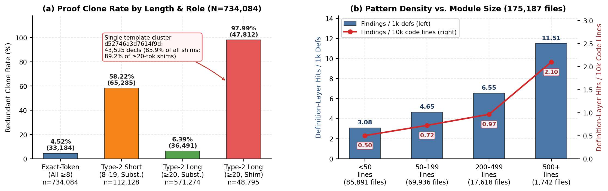
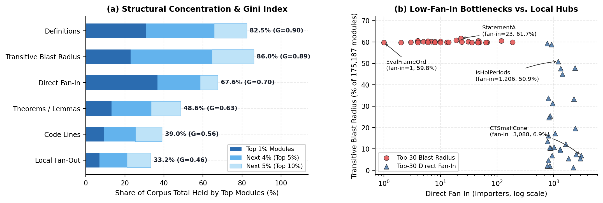

# Static Structural Audit of the 17.37-Million-Line Lean 4 Riemann Hypothesis Archive

[](LICENSE)
[](LICENSE-DATA)

An open-source, pure static lexical, syntactic-pattern, clone-decomposition, and import-topology audit suite for large-scale Lean 4 repositories, accompanied by full empirical artifacts on the 175,187-file (`17,374,215` raw lines / `15,531,759` stripped code lines) Lean 4 Riemann Hypothesis formalization archive (`leanprover/lean4:v4.33.1`).

> **Scope & Disclaimer.** This audit performs static lexical scanning, top-level (column-0) declaration parsing, and import-DAG topology analysis. It does **not** re-run the Lean 4 type checker or any external kernel, and neither certifies nor refutes the mathematical correctness of any target theorem. Syntactic patterns reported here (e.g., unused explicit parameters, constant `True`/`False` bodies, forwarding shims) represent structural indicators rather than guaranteed defects; manual inspection confirms benign instances such as legacy branch toggles (`SwOn.lean:3`) and vacuous base conditions (`IsExpansion.lean:81`).

## Key Audited Facts (`probe_bundle_sha256`: `43501e2c8041`)

- **Corpus Snapshot**: Package `tree`, toolchain `leanprover/lean4:v4.33.1`, `mathlib4` rev `0df444a360eaa60ab8c11dca51a86af692955474`, source archive `lean.tar.gz` (`239,275,554` bytes, SHA-256 `9631b4f020199e580ba86178cb56c6e9b09f690c2369a80dc4334aa93f49c7fc`).
- **Full Connectivity & Acyclicity**: `175,187 / 175,187` (`100.0%`) files reachable from `Main`; `753,261` deduplicated import edges; strict DAG (`max_depth = 202`, `p90 = 98`).
- **Trust Boundary**: `0` occurrences detected across 17 checked lexical trust-boundary primitives (`sorry`, `admit`, `sorryAx`, `mkSorry`, `native_decide`, `ofReduceBool`, `ofReduceNat`, `implemented_by`, `@[extern]`, `@[csimp]`, `debug.skipKernelTC`, `trustCompiler`, `unsafe`, `axiom`, `opaque`, `addAndCompile`, `setEnv`). Metaprogramming/environment activity concentrates in **34** deduplicated `run_tac`/`liftMetaTactic`/`partial` source sites (`64` raw hits) plus **7** environment calls (`5` `modifyEnv` in `BuildAid/D1..D5.lean`, `2` `addDecl` in `CutCptCopy.lean`), alongside `12` direct `import Lean` lines across 7 helper files (`BuildAid/D1..D5`: 10, `Imports.lean`: 1, `OwnStruct.lean`: 1; `CutCptCopy.lean` accesses `Lean` transitively), `5` `run_cmd`, `4` `elab`, and `87` `macro` rules (spot-checked samples are local `scoped macro` shorthands).
- **Type-2 Clone Stratification (`734,084` proofs $\ge 8$ tokens)**: Forwarding shims (`n=50,682`) collapse by `96.27%` (`97.99%` at $\ge 20$ tokens), with a single 3-branch forwarding template (`d52746a3d7614f9d`) accounting for **43,525** declarations (**85.9%** of all shims). By contrast, substantive proofs $\ge 20$ tokens (`n=571,274`) exhibit only **6.39%** Type-2 duplication (`cross_bucket_hash_collisions = 0`).
- **Concentration & Low-Fan-In Bottlenecks**: `transitive_blast_radius` has Gini `0.8905` (Top 10% hold `86.02%`). Top-30 blast-radius hubs (`59.70%–61.68%` impact) all have `direct_fan_in` between `1` and `188` and are completely disjoint from the Top-30 direct fan-in hubs (`775–3,088`).

> **Verification Note**: Audit and plotting scripts were developed in a human–AI collaborative workflow and validated via 10 deterministic unit/regression tests (`scripts/test_lean_probes.py`), pre-output conservation assertions (`invariants_checked.all_passed`), and raw-output cross-checks rather than line-by-line manual Python code review; all hashed scripts (`probe_bundle_sha256: 43501e2c8041...`) are included for independent inspection.

## Longitudinal Comparison: Original Archive vs. `lsernau/grh-lean` (`probe_bundle_sha256`: `43501e2c8041`)

Using the unmodified probe bundle (`43501e2c8041ccdda6b59a4c324450c9f402c1913682be1f87d82d7562adfbce`), we ran the same 4-stage static audit on the two refactored editions in [`lsernau/grh-lean`](https://github.com/lsernau/grh-lean) (commit `72fead102f663d5c7a407964a13dc0cf9d977207`, toolchain `leanprover/lean4:v4.35.0`, `mathlib4` rev `56a005855ea17e0b0958f73ec801ae140b0a1679`): the readable edition (`grh/src`) and the compact edition (`grh-compact/src`). Full longitudinal outputs are archived under [`reports/longitudinal/`](reports/longitudinal/).

| Metric | `v0` Original Archive (`lean.tar.gz`) | `grh/src` Readable Edition | `grh-compact/src` Compact Edition |
|---|---:|---:|---:|
| **Files (`src/*.lean`)** | `175,187` | `803` (`-99.54%`) | `794` (`-99.55%`) |
| **Raw Lines** | `17,374,215` | `477,124` (`-97.25%`) | `112,827` (`-99.35%`) |
| **Non-Blank Lines (Code + Comments)** | `15,531,759` | `432,527` (`-97.22%`) | `95,030` (`-99.39%`) |
| **Stripped Code Lines (Non-Empty)** | `15,531,759` | `299,902` (`-98.07%`) | `76,149` (`-99.51%`) |
| **Comment-Only Lines (`%` of Non-Blank)** | `0` (`0.00%`) | `132,625` (`30.66%`) | `18,881` (`19.87%`) |
| **Column-0 Definitions / Theorems** | `242,670` / `818,755` | `5,612` / `18,227` | `3,855` / `7,088` |
| **Standalone `by trivial` / `rfl` Proofs** | `0` / `20,023` | `0` / `445` | `0` / `119` |
| **Checked Lexical Trust-Boundary Primitives (17 items)** | `0` | `0` | `0` |
| **`run_tac` / `liftMetaTactic` / `partial` (Dedup Sites / Raw)** | `34` / `64` (`32` / `30` / `2`) | `0` / `0` | `0` / `0` |
| **Env Mutations (`modifyEnv` / `addDecl`) & `macro` Decls** | `7` (`5` / `2`) & `87` | `0` & `0` | `0` & `0` |
| **Definition-Layer Syntactic Hits (`DEF_*`)** | `1,403` (`8` rules) | `17` (`16` wildcard, `1` `_`-param) | `14` (`14` wildcard) |
| **Forwarding Shims ($\ge 8$ Tokens) & Type-2 Dup Rate** | `50,682` (`96.27%`, `48,791` dups) | `42` (`0.00%`, `0` dups) | `0` (`0.00%`, `0` dups) |
| **Substantive Proofs ($\ge 20$ Tokens) Type-2 Dup Rate** | `6.39%` (`36,491 / 571,274`) | `0.18%` (`24 / 13,205`) | `0.02%` (`1 / 4,152`) |
| **Exact-Token Proof Duplicates ($\ge 8$ Tokens)** | `33,184 / 734,084` (`4.52%`) | `29 / 16,058` (`0.18%`) | `0 / 5,716` (`0.00%`) |
| **`Main` Reachability / Deduplicated Import Edges** | `100.0%` / `753,261` | `100.0%` / `1,733` | `100.0%` / `1,398` |
| **Max Import DAG Depth (`P90`) / Zero-Decl Files** | `202` (`98`) / `174` | `53` (`39`) / `0` | `54` (`38`) / `0` |
| **`transitive_blast_radius` Gini (Top 10% Share)** | `0.8905` (`86.02%`) | `0.6336` (`43.07%`) | `0.5156` (`35.01%`) |
| **Cross-Directory Reverse Edges (`Lib` $\to$ `New`)** | Present (`Formalism` $\to$ `Dev`: `236`) | `0` (`New` $\to$ `Lib`: `208`) | `0` (`New` $\to$ `Lib`: `102`) |

- **Empirical Observations**:
  1. **Boilerplate & Metaprogramming Removal**: Forwarding shims ($\ge 8$ tokens) drop from `50,682` (`43,525` in one template) to `42` unique shims in `grh/src` and `0` in `grh-compact/src` (including `0` shims `< 8` tokens). All `34` `run_tac`/`liftMetaTactic`/`partial` sites, `7` `modifyEnv`/`addDecl` calls, `12` direct `import Lean` lines, `5` `run_cmd`, `4` `elab`, and `87` `macro` declarations measure `0` in both refactored editions.
  2. **Substantive Proof Deduplication & Documentation**: Type-2 duplication among substantive proofs ($\ge 20$ tokens) decreases from `6.39%` (`36,491` duplicates) to `0.18%` (`24` duplicates) in `grh/src` and `0.02%` (`1` duplicate out of `4,152` long proofs; `0` Exact-Token proof duplicates) in `grh-compact/src`. Comment-only lines increase from `0` (`0.00%`) in `v0` to `132,625` (`30.66%` of non-blank lines) in `grh/src` and `18,881` (`19.87%`) in `grh-compact/src`.
  3. **Definition-Layer & Topological Normalization**: Definition-layer syntactic hits decrease from `1,403` (plus `19` L2.5 `False`/dummy-constant hits) to `17` in `grh/src` and `14` in `grh-compact/src` (`0` L2.5 `False`/dummy-constant hits; the remaining hits are explicit carrier/receiver parameters `(_ : T)` and `1` `_h_read` parameter, and the `4` `DEF_SYMBOL_SHADOWING` hits in `Statements.lean` are the four canonical GRH target definitions). Import depth compresses from `202` to `53–54`, zero-declaration wrapper files drop from `174` to `0`, `Lib` $\to$ `New` reverse coupling is `0`, and `transitive_blast_radius` Gini decreases from `0.8905` to `0.6336` (`grh/src`) and `0.5156` (`grh-compact/src`).
- **Methodological & Provenance Note**: To maintain strict single-probe comparability (`probe_bundle_sha256: 43501e2c8041`), `scripts/` was executed without modification. Supplementary verification accounting for Lean 4.35 Unicode `↦` (`pp.unicode.fun = true`) and `24` single-line compacted declarations (`<cmd> in <decl>` or `/-- ... -/ <decl>`) in `grh-compact/src` (`3,864` total defs, `7,103` total theorems/lemmas; `0` in `grh/src`) confirms `0` additional `DEF_*`/`False` pattern hits and `0` additional forwarding shims. Note that because `grh-lean` was audited inside `corpus/grh-lean/`, `collect_provenance` in `reports/longitudinal/*` inherited the parent workspace's `raw/lean.tar.gz` (`9631b4f02019...`) in `source_archive`; the true version anchor for both refactored editions is `lsernau/grh-lean` Git commit `72fead102f663d5c7a407964a13dc0cf9d977207`.

## Visual Summary





## Repository Structure

- `scripts/` — Static lexer (`lean_lexer.py`), column-0 parser (`lean_decl_parser.py`), probe engine (`lean_probes.py`), L1+L2 runner (`run_audit.py`), SE topology (`se_topology.py`), L3-A reachability (`lean_dag.py`), L2.5 extended trust/dual audit (`run_l25_audit.py`), provenance helper (`audit_provenance.py`), figure generator (`plot_figures.py`), and regression suite (`test_lean_probes.py`).
- `configs/rh_archive.json` — Externalized entry roots and target symbol list (keeps Python probes repository-agnostic).
- `reports/` — Audited Markdown summaries, aggregate JSON datasets, longitudinal comparison artifacts (`reports/longitudinal/`), and publication vector figures (`reports/figures/`).
- `paper/` — 3-page LaTeX technical short paper (`paper/main.tex`, `paper/refs.bib`, `paper/main.pdf`).

## Reproducing the Audit

All core audit scripts (`scripts/run_audit.py`, `se_topology.py`, `lean_dag.py`, `run_l25_audit.py`, `test_lean_probes.py`) require **Python 3.10+ standard library only**; figure regeneration additionally requires `matplotlib` and `numpy`.

### 1. Run Deterministic Unit & Regression Tests (No Corpus Required)

```bash
python -B scripts/test_lean_probes.py
```

### 2. Regenerate Figures & Technical Report (From Committed JSONs)

```bash
pip install matplotlib numpy
python -B scripts/plot_figures.py
cd paper && pdflatex main.tex && bibtex main && pdflatex main.tex && pdflatex main.tex
```

### 3. Full End-to-End Pipeline (On the 175,187-File Archive)

1. Obtain the original release archive (`lean.tar.gz`, `239,275,554` bytes, SHA-256 `9631b4f020199e580ba86178cb56c6e9b09f690c2369a80dc4334aa93f49c7fc`), place it at `raw/lean.tar.gz` (optional, for provenance hash verification), and extract the `.lean` source tree (e.g., under `corpus/src/`).
2. Run the 4-stage pipeline from the repository root:
   ```bash
   python -B scripts/run_audit.py --root corpus/src --out-dir reports --prefix full_clean
   python -B scripts/se_topology.py \
     --dag-index reports/full_clean_dag_index.json \
     --out-dir reports --prefix full_clean_se_topology
   python -B scripts/lean_dag.py \
     --root corpus/src --dag-index reports/full_clean_dag_index.json \
     --out-dir reports --prefix full_clean \
     --entry-config configs/rh_archive.json --l3a-only
   python -B scripts/run_l25_audit.py \
     --root corpus/src --out-dir reports --prefix full_clean_l25 \
     --shadow-config configs/rh_archive.json
   python -B scripts/plot_figures.py
   ```
   - `run_audit.py` writes a ~110 MB local intermediate `reports/full_clean_dag_index.json` consumed by `se_topology.py` and `lean_dag.py`; it is excluded from Git via `.gitignore` and can be removed after downstream stages finish.
   - Core script hashes lock to `probe_bundle_sha256 = 43501e2c8041ccdda6b59a4c324450c9f402c1913682be1f87d82d7562adfbce`.

## Citation

If you use the audit scripts, datasets, or technical report, please cite:

```bibtex
@misc{Jiang_2026_lean4_static_audit,
  author       = {Jiang, Chen},
  title        = {Static Structural Audit of the 17.37-Million-Line Lean 4
                  Riemann Hypothesis Archive: Trust Boundaries, Type-2 Clones,
                  and Dependency Topology},
  year         = {2026},
  month        = nov,
  doi          = {10.5281/zenodo.24465791},
  url          = {https://doi.org/10.5281/zenodo.24465791},
  howpublished = {Zenodo}
}
```

## Dual Licensing

Report and data (`reports/`, `paper/`) are licensed under **CC BY 4.0** ([`LICENSE-DATA`](LICENSE-DATA)); audit scripts and configuration (`scripts/`, `configs/`) are licensed under **Apache-2.0** ([`LICENSE`](LICENSE)). See [`NOTICE`](NOTICE) for attribution details.
